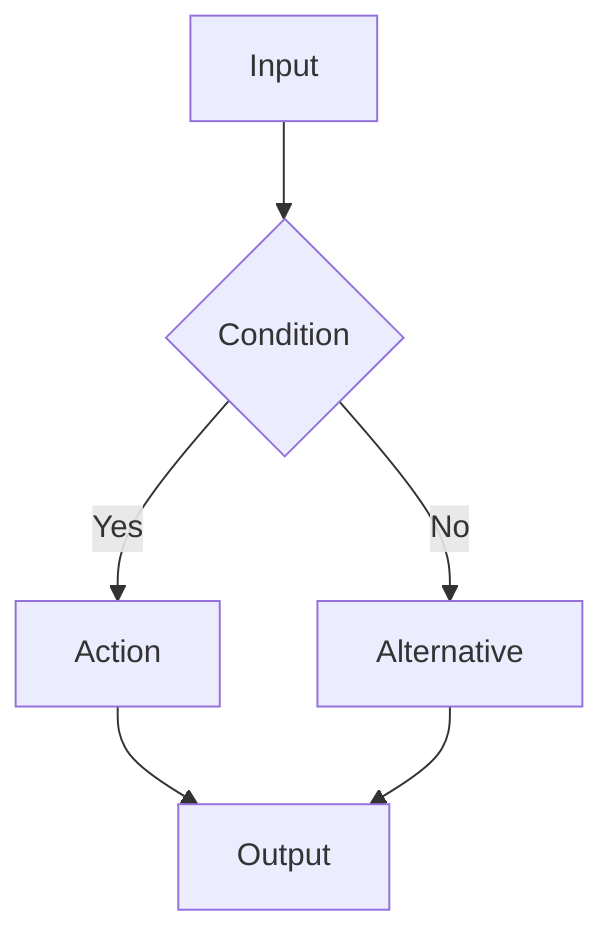
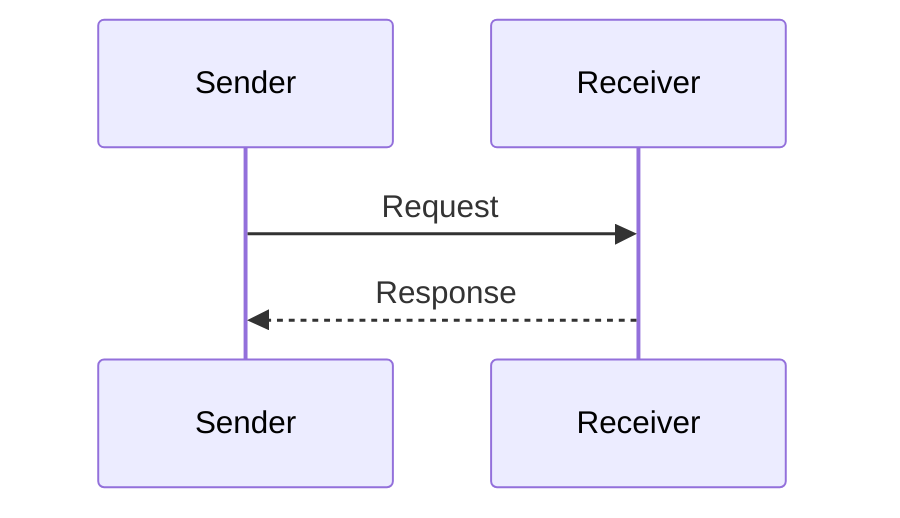
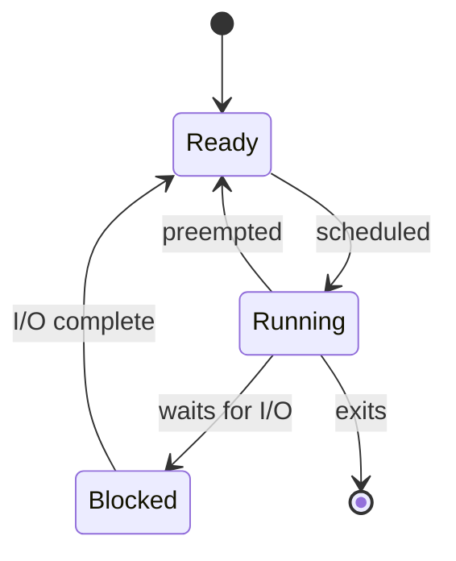
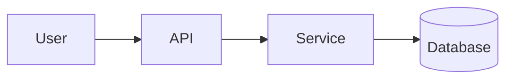

# Diagram guidelines

## Select a visual only when it adds explanatory value

| Content pattern | Preferred representation |
|---|---|
| Ordered procedure or algorithm | Flowchart |
| Components and dependencies | Block/component diagram |
| Messages exchanged over time | Sequence diagram |
| Lifecycle or protocol states | State diagram |
| Categories and containment | Tree/hierarchy |
| Alternatives and trade-offs | Comparison table |
| Quantitative relationship | Chart with labelled axes |
| Timeline | Timeline |

## Mermaid templates

### Flowchart

### Sequence diagram

### State diagram

### Component diagram

These are generic patterns only. Replace nodes and relationships with facts grounded in the source. Do not use a template's sample relationships as facts about the PDF.
